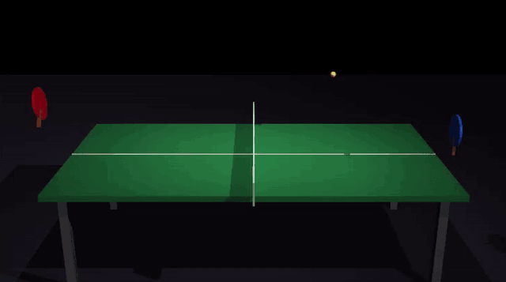

# Drex MuJoCo Ping Pong



Table tennis in [MuJoCo](https://mujoco.org/), with both racquets steered by a
[Drex](https://www.nace.ai/) decision model: the hosted Nace API by default, or a local
Drex server.

While the ball flies toward a racquet, a background thread asks Drex three questions:

- **lane:** where should the racquet move sideways?
- **style:** what kind of return? *lift* (high, safe arc), *flat* (low, fast, deep) or
  *block* (short and gentle).
- **stroke:** forehand or backhand?

The physics loop never waits for Drex. Every frame the script predicts where, when, how
fast and with what spin the ball will reach the racquet, accounting for gravity, table
bounces and spin. It then picks a return path that clears the net by the chosen style's
margin and lands at its depth. Finally it solves for the swing speed, blade tilt and
sideways blade turn that send the ball along that path. The table and blade bounce
constants are measured from the MuJoCo model at startup. If no fresh Drex answer is
available, the racquet falls back to the prediction and a lift.

## Install

You need Python 3.10 or newer. It's tested with Python 3.13 on Windows. MuJoCo comes from
pip: the `mujoco` package includes the physics engine and the interactive viewer, so you
don't need to download MuJoCo separately.

**1. Get the code**

```powershell
git clone https://github.com/aziamimoh/drex-mujoco-ping-pong.git
cd drex-mujoco-ping-pong
```

**2. Create and activate a virtual environment**

Windows (PowerShell):

```powershell
python -m venv .venv
.venv\Scripts\Activate.ps1
```

If PowerShell refuses to run `Activate.ps1` ("running scripts is disabled on this system"),
allow local scripts for your user once, then activate again:

```powershell
Set-ExecutionPolicy -Scope CurrentUser RemoteSigned
```

macOS / Linux:

```bash
python3 -m venv .venv
source .venv/bin/activate
```

**3. Install the packages**

```powershell
pip install mujoco
```

That one command is all the project needs. MuJoCo brings everything else with it: `numpy`,
`glfw` and `pyopengl` for the viewer window, plus `mujoco_core`, `mujoco_studio` and
`websockets`. To get the exact MuJoCo version this was tested with, use
`pip install -r requirements.txt` instead. To render GIFs with `make_gif.py`, also run
`pip install pillow`.

Tested environment (`pip freeze` of the working venv, Python 3.13.14 on Windows):

```
glfw==2.11.0
mujoco==4.0.1
mujoco_core==4.0.1
mujoco_studio==4.0.1
mujoco_studio_wasm==4.0.1
numpy==2.5.4
pyopengl==3.1.10
websockets==17.4
```

**4. Check that it works**

These two tests need no viewer window and no API key:

```powershell
python stroke_test.py
python bounce_test.py
```

`stroke_test.py` should end every line in `landed at x=...`. `bounce_test.py` should
show bounce values below 1 for the current setting, `0.030 0.05`.

**5. Drex access (optional)**

To use the hosted Drex model you need a Nace API key, set as an environment variable (see
below). Without one, run with `--no-drex`, or point `--url` at a local Drex server.

## Run

From this folder (the scripts load `pingpong.xml` from the current directory), with the
virtual environment active:

```powershell
# Hosted Drex API (default model drex-max-v1.1)
$env:NACE_API_KEY = "nace_sk_..."        # macOS/Linux: export NACE_API_KEY="nace_sk_..."
python pingpong_drex.py

# A local Drex server instead (no key needed)
python pingpong_drex.py --url http://127.0.0.1:8000/v1/systemone

# No model at all: the racquets use the prediction alone
python pingpong_drex.py --no-drex

# Slow motion (also gives Drex more time per decision)
python pingpong_drex.py --sim-speed 0.5
```

On macOS, MuJoCo's viewer window has to be started with `mjpython` (installed with the
`mujoco` package) instead of `python`: `mjpython pingpong_drex.py`. The headless scripts
(`stroke_test.py`, `bounce_test.py`, `make_gif.py`) work with plain `python`.

After every return the console prints what was aimed for and where the ball went, e.g.

```
R lift  forehand swing 1.30 m/s  tilt +0.59  yaw +0.00  (solver miss 0.00 m/s)  aimed x=-0.75 y=+0.00  -> landed at x=-0.79 y=-0.00
```

Run `python pingpong_drex.py --help` for all options: request timeout, how long an answer
stays valid, the minimum gap between Drex calls (the hosted API bills per request), serve
speed, and `--quiet`.

## Files

| File | What it is |
|---|---|
| `pingpong.xml` | The scene: a regulation-size table, net, 40 mm / 2.7 g ball, and two racquets that swing (x), slide (y, z), turn (yaw), tilt and roll |
| `pingpong_drex.py` | The game: Drex client, ball-flight prediction, stroke solver and racquet control |
| `pingpong_controller.py` | The original simple controller (straight-line aiming, no model) |
| `requirements.txt` | The tested MuJoCo version (`pip install -r requirements.txt`; plain `pip install mujoco` also works) |
| `make_gif.py` | Renders a clip of the game straight from MuJoCo and saves it as an animated GIF (`python make_gif.py`, or `--drex` to steer with the hosted model) |
| `stroke_test.py` | Headless test: fires balls at each racquet and compares the planned stroke with what MuJoCo does |
| `bounce_test.py` | Headless test: measures ball bounce restitution for several contact settings |
| `debug.py`, `test_simulation.py` | Small checks that the model loads and the ball bounces |

## Notes

- Hinge-joint ranges in `pingpong.xml` are in **degrees** (MuJoCo's default unit for
  angles in XML), while joint positions and control values are in radians.
- The contact setting `solref="0.03 0.05"` gives bounces that keep about 86% of their
  speed. Much stiffer settings (such as `0.004 0.08`) make each contact too short for the
  0.5 ms timestep, and the ball gains energy on every bounce. Use `bounce_test.py` to
  check any change.
